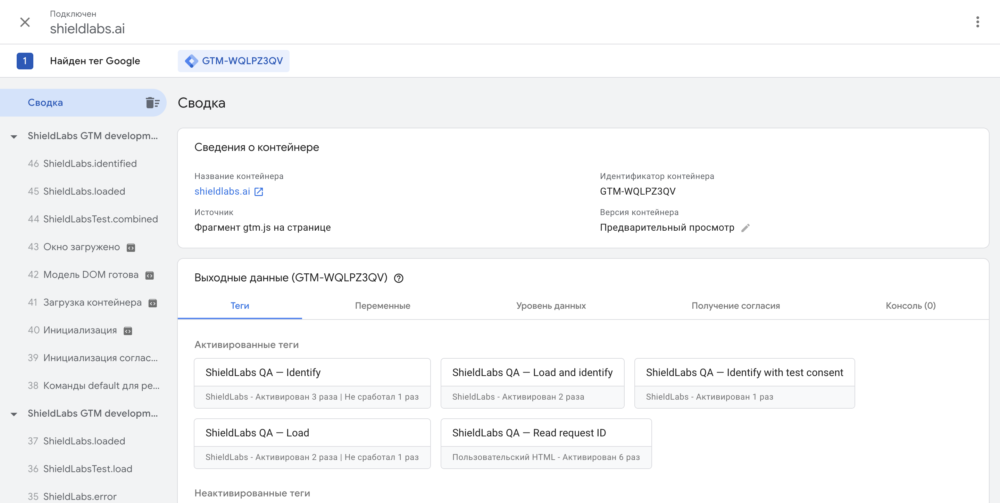

# Verification

## Automated and native tests

Version 1.0.0 has 37 automated behavior tests and five tests included in the GTM template. Both suites passed during the initial live verification. Automated cases cover validation, modes, repeated calls, load recovery, isolation by key/environment, permission failures and wall-clock timeout races.

## Live GTM verification

On 3 October 2026, the template was imported into a real GTM web container and tested through Preview on the ShieldLabs development landing. The final run used the existing checker's production-service configuration.

| Check | Result |
| --- | --- |
| Identify before loading | Expected `not_loaded` failure |
| Load only | Agent loaded without an identification request |
| Anonymous identification | Matching History row |
| User HID identification | Matching History row and exact supplied User HID |
| Consent denied | Protected GTM tag blocked |
| Consent granted | Identification and matching History row |
| Consent withdrawn | Protected GTM tag blocked |
| Warm combined mode | Matching History row |
| Repeated identification | Fresh ID and matching History row |
| Simulated adapter HTTP 503 | Expected `load_failed` failure |
| Recovery without reloading the page | Agent loaded successfully |
| Cold combined mode | Matching History row |

All six resulting request IDs were read by a downstream GTM tag using a real Data Layer Variable and retrieved through the History API. Each History row contained the corresponding request ID, Visitor ID and Device ID. Identification and follow-up requests captured on ShieldLabs services returned HTTP 200. Tag Assistant reported zero console errors.

## Public release hosting

On 4 October 2026, the release template was rebuilt for the versioned GitHub Pages adapter URL, reimported into the real GTM container and saved. All five native tests passed again. The public adapter returned HTTP 200 with a JavaScript MIME type and matched the tested bundle byte for byte (SHA-256 `12e5aaa56e48fcebd446724f8b80eca2dc2b65dcdabb594e8bd76cf267505b05`).

A fresh cold Load and identify run loaded the adapter from GitHub Pages and the agent from the production ShieldLabs CDN on the development landing. The downstream GTM tag read the new request ID, and the corresponding History row returned that ID, Visitor ID and Device ID. Captured identification and follow-up requests returned HTTP 200; Tag Assistant reported zero console errors.

GitHub CI passed the automated checks on Node 20, 22 and 24. The GitHub Pages deployment also completed successfully.

## Scope

These checks establish the integration's behavior in the tested browser, container and environment. They do not guarantee delivery through every content blocker or site CSP. The development test workspace remains unpublished; customers import the template and publish their own containers.

Native GTM consent blocks tag execution. It does not unload a hosted agent that has already started; see the consent instructions in the README.
